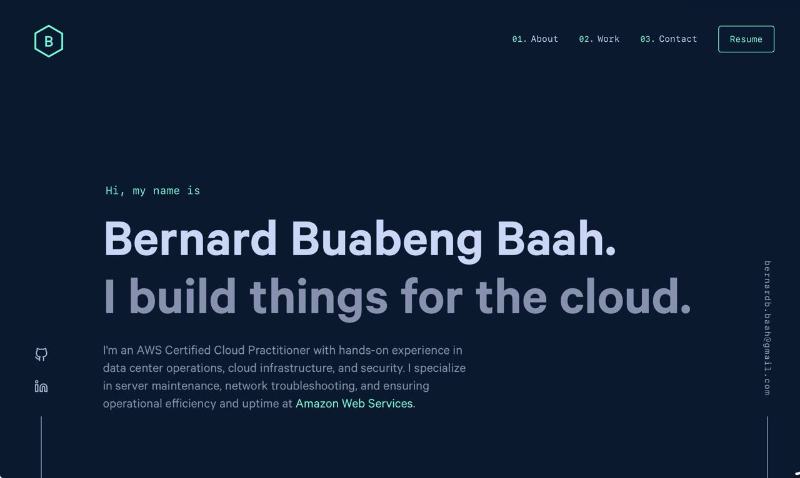

<div align="center">
  
</div>

<h1 align="center">
  bernardbaah.com
</h1>

<p align="center">
  Personal portfolio website of <a href="https://www.bernardbaah.com" target="_blank">Bernard Buabeng Baah</a> — AWS Certified Cloud Practitioner & Data Center Technician. Built with <a href="https://www.gatsbyjs.com/" target="_blank">Gatsby 5</a> and React 18, hosted on <a href="https://aws.amazon.com/amplify/" target="_blank">AWS Amplify</a>.
</p>

<p align="center">
  Based on the original design by <a href="https://brittanychiang.com" target="_blank">Brittany Chiang</a> — used with attribution.
</p>



## v2 changes

This is a from-scratch repository replacing [`bernard-iteration1-portfolio`](https://github.com/Bernard-Baah/Bernard-iteration1-portfolio):

- Removed leftover template content (placeholder work history, sample projects, and demo blog posts that shipped with the original template) — the "Work Experience", "Other Projects" (`/archive`), and "Pensieve" blog features were removed along with them since there's no real content for them yet. They can be reintroduced later by re-adding `content/jobs`, `content/projects`, `content/posts`, and their corresponding pages/components from git history.
- Upgraded Gatsby 3 → 5, React 17 → 18, and the full plugin set to their current majors.
- Dropped the dead Universal Analytics integration (Google sunset UA in July 2023) — no analytics are wired up currently; add GA4 (`gatsby-plugin-google-gtag`) or a privacy-friendly alternative (Plausible, Fathom, Umami) when ready.
- Requires Node 18+ (`.nvmrc` pinned to 20).

## 🛠 Installation & Set Up

1. Install dependencies

   ```sh
   yarn install
   ```

2. Start the development server

   ```sh
   yarn develop
   ```

## 🚀 Building & Deploying

1. Generate a production build

   ```sh
   yarn build
   ```

2. Preview the production build locally

   ```sh
   yarn serve
   ```

## 🎨 Color Reference

| Color          | Hex                                                                |
| -------------- | ------------------------------------------------------------------ |
| Navy           |  `#0a192f` |
| Light Navy     |  `#112240` |
| Lightest Navy  |  `#233554` |
| Green          |  `#64ffda` |

## 📄 License

This project is based on [brittanychiang.com v4](https://github.com/bchiang7/v4) by Brittany Chiang. Please give proper credit if you fork or use this code.
